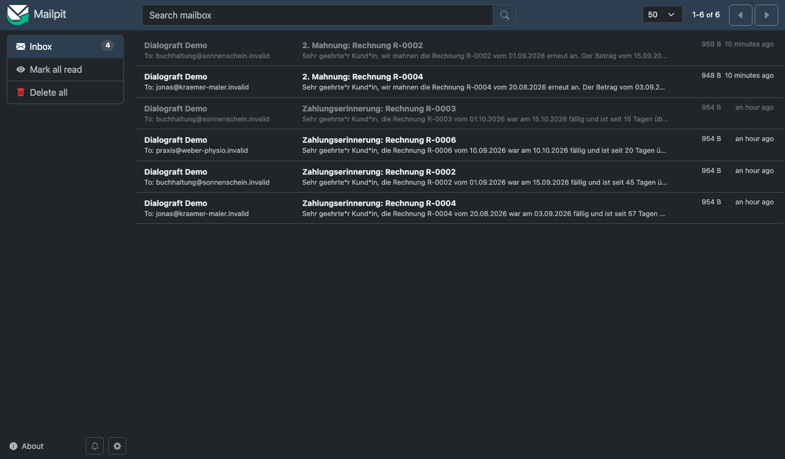
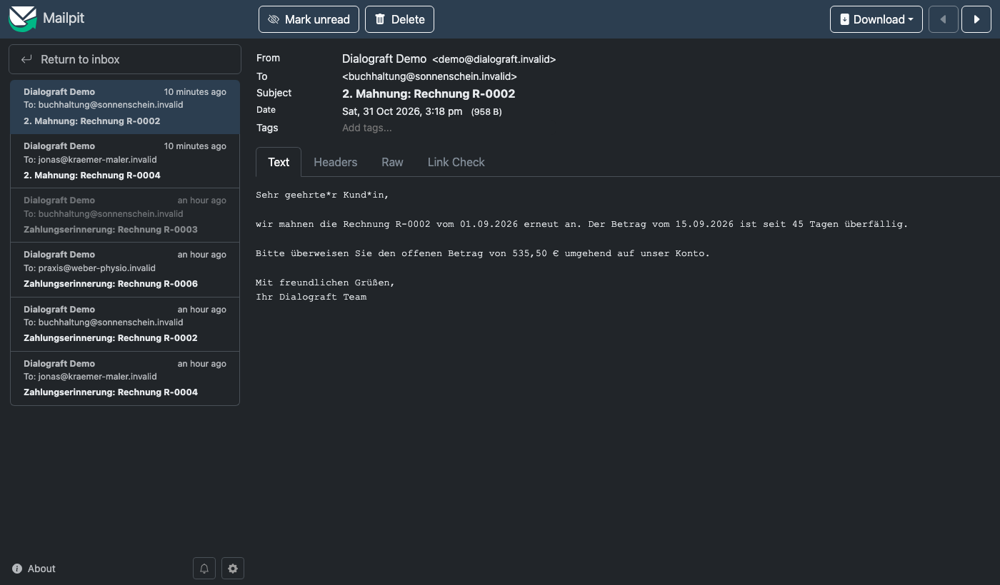

# Dialograft

*Software evolves through conversation.*

Demo einer kleinen Rechnungs-SaaS für Dienstleister, die per Chat (zuerst Claude Code über MCP) bedient wird – und die eine fehlende Funktion im Gespräch aufnimmt, klärt, bewerten lässt, ein unverbindliches Entwicklungsangebot erstellt und nach Annahme durch einen lokalen Coding-Agenten als Draft-PR umsetzen lässt. Review, Merge und Deployment bleiben menschliche, getrennte Schritte.

Alle Daten sind Demo-Daten, keine Buchhaltungsbelege.

## Showcase

Live erprobt am 31.10.2026 auf einem Mac (OrbStack, Ollama, Qwen Code): drei Erweiterungen liefen jeweils vom Wunsch im Chat über Klärung, Bewertung, Angebot, Agentenlauf, Review und Merge bis zum Deployment – darunter automatische Mahnstufen und ein CSV-Export. Schutzregeln und Reviews haben dabei mehrfach eingegriffen; Details im [Prüfbericht](docs/VERIFICATION.md).

| Mahnungen im lokalen Testpostfach | Einzelne Mahnung |
|---|---|
|  |  |

Live-Vorführung auf Anfrage über LinkedIn oder GitHub.

## Architektur

```
Claude Code ──MCP (Streamable HTTP, Token A)──▶ mcp ──HTTP (Token B)──▶ api ──▶ MySQL
                                                                         │      (Aggregate, Jobs, Notifications,
                                                                         │       Audit, Receipts)
                                                   worker ◀──Jobs────────┘
                                                     │  ├─▶ GitHub (Issue, Labels, Draft-PR)
                                                     │  ├─▶ Ollama (qwen3-coder:30b) – Bewertung
                                                     │  └─▶ Runner-Controller (nativ, Token D)
                                                     │          └─▶ docker run dialograft-coder (Qwen Code, kurzlebig)
operator (Token C) ──▶ api: requeue / approve-merge / deployed
```

| Modul | Pfad |
|---|---|
| Fachlogik (Kunden, Angebote, Rechnungen, Zahlungen, Offene Posten, Reports) | `src/services/billing.ts` |
| PDF / XLSX | `src/services/exports.ts`, `src/services/artifacts.ts` |
| Erweiterungen: Scope, Bestätigung, Routing, Angebot, Auftrag | `src/services/features.ts`, `src/services/pricing.ts` |
| Werkzeugkatalog (Zod = einzige Quelle) | `src/tools/schemas.ts`, `src/tools/registry.ts` |
| API (Fastify, `/v1/tools/:name`, Operator-Endpunkte, Downloads) | `src/api/` |
| MCP-Adapter (stateless Streamable HTTP) | `src/mcp/server.ts` |
| Store-Vertrag, MySQL (mysql2), Test-Store | `src/store/`, `migrations/` |
| Worker (Bewertung, Umsetzung, Pausieren) | `src/worker/handlers.ts` |
| GitHub / Snapshot / Ollama | `src/adapters/` |
| Runner-Controller, Pfadregeln, Workspace-Diff | `src/runner/`, `docker/coder.Dockerfile` |
| Kubernetes (OrbStack), Skripte | `k8s/`, `scripts/` |
| Generierte Verträge | `contracts/openapi.json`, `contracts/mcp-tools.json` |

### Sicherheitsgrundsätze
- Drei getrennte Tokens: Client→MCP, MCP→API, Operator (plus Runner-Token). Fehlend/falsch → 401, falsche Rolle/Recht → 403.
- Mandant wird serverseitig bestimmt; Eingaben mit unbekannten Feldern (z. B. `tenantId`) werden abgelehnt (`strictObject`).
- Bestätigungspflichtige Werkzeuge verlangen `confirm: true`; Scope-Bestätigung, Angebotsannahme und Deployment-Freigabe sind getrennte Schritte.
- Testmail nur an `.invalid`-Adressen. Keine automatischen Zahlungserinnerungen im Ausgangsstand (bewusste Produktlücke, siehe `list_capabilities`).
- Bewertung: nur freigegebene Dateien eines fixierten Commits; jeder Codebeleg muss wörtlich im Snapshot vorkommen; Blocker, ungültige Belege oder unvollständiger Kontext → `needs-human`.
- Runner: Container ohne Docker-Socket, DB-, GitHub-, Kube- oder Home-Zugriff; `--cap-drop ALL`, read-only Rootfs, Ressourcen- und Zeitlimit; Checks mit `--network none`. Änderungen nur an erlaubten `.ts`-Dateien; Symlinks, Löschungen, Dependencies, Infrastruktur, Auth/Config/Runner/Worker und bestehende Tests sind geschützt. Worker prüft Ergebnisse erneut, bevor er einen Draft-PR erstellt.
- Grenzen: Container-Isolation ersetzt keine vollständige Egress-Kontrolle; nur für das kontrollierte Demo-Repository gedacht.

## Lokal entwickeln

```bash
npm ci
npm run typecheck && npm test && npm run build
# MySQL-Integrationstest (sonst explizit übersprungen):
DIALOGRAFT_TEST_DATABASE_URL=mysql://user:pw@127.0.0.1:3306/db npm test
npm run contracts   # OpenAPI + MCP-Katalog neu erzeugen
```

## Betrieb auf dem Mac (OrbStack)

1. Secrets erzeugen: `npm run build && node dist/src/cli/gen-secrets.js > .env`, dann `.env.example` als Vorlage für die übrigen Werte ergänzen (`GITHUB_TOKEN` mit Issues/PR/Contents-Rechten nur für dieses Repo).
2. `scripts/k8s-secrets.sh .env` – legt das Kubernetes-Secret an (Skripte verweigern andere kube-Kontexte als `orbstack`).
3. `scripts/up.sh` – baut `dialograft:local`, startet MySQL, Mailpit, API, MCP, Worker.
4. `scripts/migrate-seed.sh` – explizite Migration + Seed (kein Reset; Seed wird übersprungen, wenn Daten existieren).
5. `scripts/port-forward.sh` – MCP auf `127.0.0.1:8081`, Mailpit-UI auf `127.0.0.1:8025`.
6. Ollama nativ: `ollama pull qwen3-coder-next:q8_0` (live erprobt; `qwen3-coder:30b` bewertet weniger zuverlässig, siehe Prüfbericht). Ollama nur an localhost binden; OrbStack erreicht es über `host.internal`.
7. Runner: `scripts/runner.sh` (baut bei Bedarf das Coding-Image `dialograft-coder:local` und startet den Controller im Vordergrund auf `127.0.0.1:8090`; OrbStack-Pods erreichen ihn über `host.internal`). Er klont aus dem lokalen Checkout, braucht also keine Git-Zugangsdaten – der Checkout muss `main` entsprechen. Modell über `RUNNER_MODEL`, Standard `qwen3-coder-next:q8_0`. Der Worker startet Läufe asynchron und fragt den Status ab; der Runner erzeugt `contracts/` nach dem Agentenlauf selbst.
8. Claude Code verbinden:
   ```bash
   claude mcp add --transport http dialograft http://127.0.0.1:8081/mcp --header "Authorization: Bearer $MCP_CLIENT_TOKEN"
   ```

Verwaiste Exportdateien (nach fehlgeschlagenen Transaktionen): `npm run sweep-exports` zeigt sie an, `npm run sweep-exports -- --delete` entfernt sie.

Operator-Aktionen: `scripts/operator.sh requeue FR-0001 assess "Begründung"`, `scripts/operator.sh approve-merge FR-0001 <sha>`, Deployment: `scripts/deploy-approved.sh FR-0001 <sha>`.

Prüfstand: [docs/VERIFICATION.md](docs/VERIFICATION.md).

## Lizenz

[MIT](LICENSE) © 2026 Ioannis Koulouris
